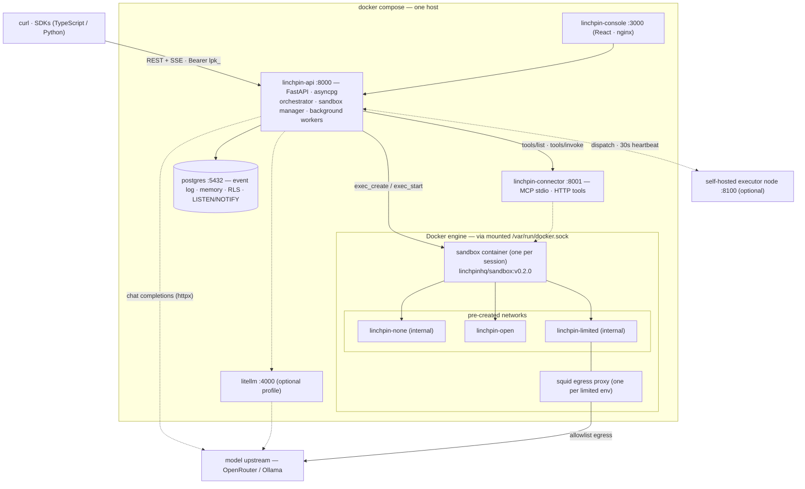
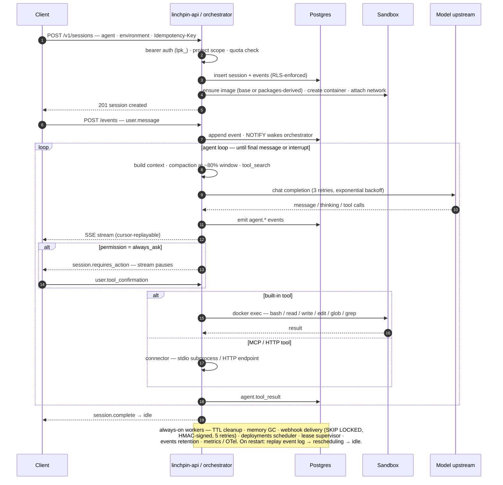

# Linchpin

> Open-source, self-hostable runtime for managed AI agents. Apache-2.0.

<p align="center">
  <a href="https://linchpin.work"></a>
</p>

<p align="center">
  <a href="https://linchpin.work">Website</a>
  ·
  <a href="https://linchpin.work/architecture">Architecture</a>
  ·
  <a href="ARCHITECTURE.md">Internals</a>
  ·
  <a href="CONTRIBUTING.md">Contributing</a>
</p>

Linchpin is an open standard and self-hostable runtime for **managed AI agents**. Run a managed-agent system on your own infrastructure with the widest possible model coverage — every cloud model via [OpenRouter](https://openrouter.ai) (Claude, GPT, Gemini, Llama, DeepSeek, Mistral, Qwen, …) plus local models via [Ollama](https://ollama.com) — without vendor lock-in.

You define **agents** (model + system prompt + tools + permissions) and **environments** (container templates). You start a **session** and Linchpin spins up an isolated sandbox, drives the agent loop, and streams every message, tool call, and status change back to you over SSE.

## Quick start

Requires Docker + Docker Compose.

```bash
git clone https://github.com/flowagent-sh/linchpin.git
cd linchpin
cp .env.example .env   # set LINCHPIN_API_KEY + your model provider key
docker compose up --build
```

| URL | What |
|---|---|
| `http://localhost:8000` | API |
| `http://localhost:3000` | Web console |
| `http://localhost:8001` | Connector (internal) |
| `http://localhost:8000/docs` | Interactive OpenAPI docs |

### Environment variables

All variables are interpolated by `docker-compose.yml` from `.env` — see [.env.example](.env.example).

| Variable | Required | Notes |
|---|---|---|
| `LINCHPIN_API_KEY` | yes | Bearer token for the API (`lpk_` prefix) |
| `VAULT_ENCRYPTION_KEY` | yes | Fernet key for credential encryption at rest — generate with `python3 -c "from cryptography.fernet import Fernet; print(Fernet.generate_key().decode())"` |
| `OPENROUTER_API_KEY` | for cloud models | Get one at https://openrouter.ai/keys |
| `CORS_ALLOWED_ORIGINS` | no | Defaults to `http://localhost:3000` |
| `VITE_API_URL` | no | Console → API base URL (when not same-origin) |
| `LITELLM_MASTER_KEY` | no | Only for the optional LiteLLM gateway profile |

For Ollama, point an agent's `model.base_url` at your Ollama instance — no env var needed.

## Deployment

`docker compose up` starts four services; everything session-scoped is created dynamically by the API through the mounted Docker socket:



- Each sandbox attaches to exactly one of the three pre-created networks, chosen by the environment's `networking.type`: `linchpin-none` (no egress), `linchpin-open` (unrestricted), `linchpin-limited` (internal bridge — egress only through the per-environment squid allowlist proxy).
- `litellm` is opt-in (`--profile litellm`) for OpenAI-compatible upstream routing — see [docs/model-gateway.md](docs/model-gateway.md).
- Optional self-hosted executor nodes run the daemon on any host and receive dispatched sessions — see [Self-hosted executor nodes](#self-hosted-executor-nodes).

## Hello world

All requests need `Authorization: Bearer $LINCHPIN_API_KEY`.

```bash
# 1. Create an environment
curl -sX POST http://localhost:8000/v1/environments \
  -H "Authorization: Bearer $LINCHPIN_API_KEY" -H "Content-Type: application/json" \
  -d '{"name":"default","config":{"networking":{"type":"unrestricted"}}}'

# 2. Create an agent
curl -sX POST http://localhost:8000/v1/agents \
  -H "Authorization: Bearer $LINCHPIN_API_KEY" -H "Content-Type: application/json" \
  -d '{
    "name": "coder",
    "model": {"provider": "openrouter", "id": "anthropic/claude-sonnet-4"},
    "system": "You are a careful Python engineer.",
    "tools": [
      {"name": "bash",  "permission": "always_ask"},
      {"name": "read",  "permission": "always_allow"},
      {"name": "write", "permission": "always_ask"},
      {"name": "edit",  "permission": "always_ask"},
      {"name": "glob",  "permission": "always_allow"},
      {"name": "grep",  "permission": "always_allow"}
    ]
  }'

# 3. Start a session
curl -sX POST http://localhost:8000/v1/sessions \
  -H "Authorization: Bearer $LINCHPIN_API_KEY" -H "Content-Type: application/json" \
  -d '{"agent_id":"<id>","environment_id":"<id>"}'

# 4. Send a message
curl -sX POST http://localhost:8000/v1/sessions/<id>/events \
  -H "Authorization: Bearer $LINCHPIN_API_KEY" -H "Content-Type: application/json" \
  -d '{"type":"user.message","payload":{"text":"List the files in /workspace"}}'

# 5. Stream the response
curl -N http://localhost:8000/v1/sessions/<id>/stream \
  -H "Authorization: Bearer $LINCHPIN_API_KEY"
```

When the agent calls a tool with `always_ask`, the stream emits `session.requires_action`. Approve with:

```bash
curl -sX POST http://localhost:8000/v1/sessions/<id>/events \
  -H "Authorization: Bearer $LINCHPIN_API_KEY" -H "Content-Type: application/json" \
  -d '{"type":"user.tool_confirmation","payload":{"tool_use_id":"...","approved":true}}'
```

Or use the web console at `http://localhost:3000`.

## What you can do

### Agents

Versioned configs: model, system prompt, tools, MCP servers, per-tool permissions. Editing an agent bumps its version; existing sessions keep running against the version they were created with. Agents can be archived and their full version history is browsable.

Agents with many MCP tools can enable `tool_search` — past a threshold (default 20 tools) the model sees a single `tool_search` meta-tool and discovers the rest on demand, instead of every schema in context.

### Models

| Provider | Where it runs | What you get |
|---|---|---|
| `openrouter` | Cloud (via OpenRouter) | ~200 models — Claude, GPT, Gemini, Llama, DeepSeek, Mistral, Qwen, … |
| `ollama` | Your machine | Whatever you've `ollama pull`'d locally |

OpenRouter model ids use the upstream-provider prefix (`anthropic/claude-sonnet-4`, `openai/gpt-4o`, `google/gemini-2.5-pro`, `meta-llama/llama-3.1-405b`, …). For Ollama, pass the local model tag (`llama3`, `qwen2.5-coder`, …) and set `base_url` to your Ollama endpoint.

Need a self-hosted or custom OpenAI-compatible model (vLLM, your own fine-tune, per-agent budgets)? Route agents through the optional bundled LiteLLM gateway (`docker compose --profile litellm up`) — see [docs/model-gateway.md](docs/model-gateway.md).

### Built-in tools

`bash` · `read` · `write` · `edit` · `glob` · `grep` · `web_fetch` · `web_search`

All execute inside the session's sandbox.

### Custom tools

Two ways to extend an agent's toolbox:

- **MCP servers** — configure `command` / `args` / `env`; the connector runs each as a stdio subprocess.
- **HTTP tools** — configure an `endpoint`; the connector POSTs the tool call and returns the response.

### Permissions

Each tool entry on an agent is either `always_allow` (execute immediately) or `always_ask` (block on `user.tool_confirmation`).

### Sandboxing

Each session runs in its own sandbox: a Debian 13 (trixie) container with Python 3.13, Node 20, Go 1.22, Rust 1.77, Java 21, Ruby 3.3, PHP 8.4, GCC 13, plus `git`, `psql`, `redis-cli`, `ripgrep`, `tree`, and `htop`. Image: [`linchpinhq/sandbox:v0.2.0`](linchpin-sandbox/Dockerfile) — extend it or bake your own.

- **Resource tiers** — per-environment sizing: `1c2g`, `2c4g`, or `4c8g` (CPU/memory).
- **Extra packages** — declare `packages` on an environment and Linchpin builds a derived sandbox image with them installed.
- **Filesystem** — the agent works in `/workspace`; `/mnt/data` is a read-only mount; `/mnt/session/outputs` is where artifacts land.

Three execution runtimes, chosen per environment (`isolation`) and per node:

| Runtime | When |
|---|---|
| **Docker** (default) | Standard container isolation on the API host |
| **microVM** | Stronger VM-level isolation (`LINCHPIN_ENABLE_MICROVM`) |
| **Remote executor** | Your own hosts — run the executor daemon anywhere and register it; sessions are dispatched to it |

### Networking

Outbound network is controlled per environment:

| `networking.type` | Behavior |
|---|---|
| `none` | No outbound network |
| `unrestricted` | Full outbound network |
| `limited` | Egress through a per-environment squid proxy with an allowlist |

`limited` mode accepts up to 256 `allowed_hosts` entries (hostnames, IPv4, or `*.wildcard` patterns) plus curated switches — `allow_mcp_servers` and `allow_package_managers` — that pre-allow common registries.

### Credential vaults

Encrypted credential storage (Fernet at rest). Reference credentials by name from agent MCP server configs; they're decrypted and injected as env vars when the session starts. Supported types: `bearer_token`, `api_key`, `oauth`, and `byok_kek`.

**Bring your own key (BYOK):** register a client-held key-encryption-key as a `byok_kek` credential and pass `x-kek-credential-id` when creating a session — data keys are wrapped client-side (`byok1` envelope) so the server never sees your raw KEK. Session event payloads can likewise be encrypted at rest (`x-events-encrypted`).

### Memory

Durable memory beyond a single session:

- **Memory stores** hold named collections of facts.
- **Memories** are individual entries with full **version history**; sensitive content can be redacted retroactively via the redact endpoint.
- A background garbage collector prunes per retention policy.

**Dreams** *(research preview)*: point a dreamer agent at a goal and it spawns up to 100 worker sessions to explore, experiment, and report back autonomously. Enable with `LINCHPIN_DREAMER_AGENT_ID`.

### Sessions & threads

- **Sub-agent threads** — spawn child threads under a parent session (`/v1/sessions/{parent_id}/threads`) for parallel or delegated work.
- **Context compaction** — when a session nears ~80% of the model's context window, older turns are summarized into a `<session_summary>` and injected, preserving tool_use/tool_result pairing at turn boundaries. Long sessions keep going.
- **Session filesystem & resources** — browse the sandbox filesystem and session-scoped resources over the API.
- **Event log** — every message, tool call, and status change is an immutable, cursor-paginated event; replay any session from any point via `?cursor=`.

### Files & artifacts

Upload files for sessions to consume (`/v1/files`) and read back what agents produced (`/v1/artifacts`), both with content-download endpoints.

### Skills

Package reusable agent know-how as skills: a `tar.gz`/`zip` bundle with a `SKILL.md` (name + description frontmatter, instructions, optional scripts) — see [examples/skills/gh-pr](examples/skills/gh-pr). Upload via `POST /v1/skills`; bundles are content-addressed and mounted into sandboxes.

### Scheduled deployments

Turn any agent + environment into a cron job: create a deployment with a cron expression and IANA timezone, optional initial events, then `pause`/`resume` it. The scheduler fires each run as a fresh session.

### Webhooks

Register HTTP endpoints and receive signed event deliveries for session lifecycle activity; inspect per-endpoint delivery history.

### Multi-tenancy

- **Projects** scope every resource; a bootstrap key sets per-project **quotas** (sessions, tokens, and more).
- **API keys** (`lpk_` prefix) are project-scoped and optionally rate-limited.
- **Row-level security** in Postgres enforces project isolation at the database layer, not just in application code.

### Reliability

- **Idempotency** — `Idempotency-Key` on session/thread creation makes retries safe.
- **Crash recovery** — the orchestrator recovers in-flight sessions; a lease supervisor lets multiple API replicas share work and take over from failed ones.
- **Retention** — TTL cleanup for dead sandboxes and configurable event retention (`LINCHPIN_EVENTS_RETENTION_DAYS`, default 90); sessions, agents, and environments support archive instead of delete.

### Observability

- `GET /metrics` — Prometheus metrics (no auth, for your scraper).
- **OpenTelemetry tracing** — enable with `LINCHPIN_OTEL_ENABLED`.
- `GET /v1/usage` — token usage by day or project (input / output / cache write / cache read).
- `GET /v1/audit` — audit log of administrative actions.

### Self-hosted executor nodes

Run sessions on your own machines: start the executor daemon (`uvicorn app.executor_daemon:app --port 8100`), register the node via `POST /v1/executor-nodes`, and it heartbeats every 30s. Sessions are dispatched to nodes with capacity, authenticated with `LINCHPIN_EXECUTOR_TOKEN`.

### SDKs

Official clients so you don't have to hand-roll curl:

- **TypeScript** — [linchpin-sdk-ts](linchpin-sdk-ts)
- **Python** — [linchpin-sdk-py](linchpin-sdk-py)

### Web console

A React UI for browsing agents/environments/sessions and chatting with agents live.

## API reference

All endpoints live under `/v1` and require bearer auth (`/health` and `/metrics` are unauthenticated). Errors use a unified envelope — see [docs/error-codes.md](docs/error-codes.md). Rate limits and project quotas are opt-in — see [docs/limits.md](docs/limits.md). Browse the interactive OpenAPI docs at `/docs`.

| Resource | Endpoints |
|---|---|
| Projects | `GET /v1/projects` · `PATCH /v1/projects/{id}` (quotas, bootstrap key only) |
| API keys | `POST GET /v1/api-keys` · `DELETE /v1/api-keys/{id}` |
| Agents | `POST GET /v1/agents` · `GET PATCH /v1/agents/{id}` · `GET /v1/agents/{id}/versions` · `POST /v1/agents/{id}/archive` |
| Environments | `POST GET /v1/environments` · `GET DELETE /v1/environments/{id}` · `POST /v1/environments/{id}/archive` |
| Sessions | `POST GET /v1/sessions` · `GET POST DELETE /v1/sessions/{id}` (POST = update title/metadata) · `POST /v1/sessions/{id}/archive` · `GET /v1/sessions/{id}/streaming` |
| Session events | `POST GET /v1/sessions/{id}/events` (POST also accepts batches) · `GET /v1/sessions/{id}/stream` (SSE, `?cursor=` replay) |
| Session filesystem | `GET /v1/sessions/{id}/filesystem` · `GET .../filesystem/raw` · `GET /v1/sessions/{id}/resources` |
| Threads | `POST GET /v1/sessions/{parent_id}/threads` (sub-agent threads) |
| Files | `POST GET /v1/files` · `GET DELETE /v1/files/{id}` · `GET /v1/files/{id}/content` |
| Artifacts | `GET /v1/artifacts` · `GET /v1/artifacts/{id}` · `GET /v1/artifacts/{id}/content` |
| Memory stores | `POST GET /v1/memory_stores` · `GET PATCH DELETE /v1/memory_stores/{store_id}` · `POST .../archive` |
| Memories | `POST PATCH GET DELETE /v1/memory_stores/{store_id}/memories` |
| Memory versions | `GET /v1/memory_stores/{store_id}/memory_versions` · `GET .../{version_id}` · `GET .../content` · `POST .../{version_id}/redact` |
| Dreams | `POST GET /v1/dreams` · `GET /v1/dreams/{id}` · `POST /v1/dreams/{id}/cancel` |
| Skills | `POST GET /v1/skills` (upload bundle) · `GET DELETE /v1/skills/{id}` |
| Vaults | `POST GET /v1/vaults` · `POST GET /v1/vaults/{id}/credentials` (max 20 per vault) |
| Webhooks | `POST GET /v1/webhook_endpoints` · `GET PATCH DELETE /v1/webhook_endpoints/{id}` · `GET .../deliveries` |
| Deployments | `POST GET /v1/deployments` · `GET PATCH DELETE /v1/deployments/{id}` · `POST .../pause` · `POST .../resume` |
| Executor nodes | `POST GET /v1/executor-nodes` · `GET DELETE /v1/executor-nodes/{node_id}` |
| Usage | `GET /v1/usage?from=&to=&group_by=day\|project` |
| Audit | `GET /v1/audit` |
| Ops | `GET /health` · `GET /metrics` (Prometheus) — no auth |

## Development

```bash
# API
cd linchpin-api
uv venv && source .venv/bin/activate
uv pip install -e ".[dev]"
alembic upgrade head
uvicorn app.main:app --reload
pytest

# Connector
cd ../linchpin-connector
uv pip install -e ".[dev]"
pytest

# Console
cd ../linchpin-console
pnpm install && pnpm dev
pnpm test

# SDKs
cd ../linchpin-sdk-ts   && npm install && npm test
cd ../linchpin-sdk-py   && pip install -e ".[dev]" && pytest
```

## How it works

One POST creates a sandbox; from there the orchestrator loop turns events into model calls and tool executions, streaming everything back over SSE:



For the session state machine, orchestrator loop, event taxonomy, component breakdown, and repo layout, see [ARCHITECTURE.md](ARCHITECTURE.md).

Per-feature specs (requirements · design · tasks) live under [`.kiro/specs/`](.kiro/specs/).

## License

[Apache-2.0](LICENSE). Copyright © 2026 Flow Agent Inc. and Linchpin contributors.

See [CONTRIBUTING.md](CONTRIBUTING.md) for the developer certificate of origin (DCO) sign-off requirement.
